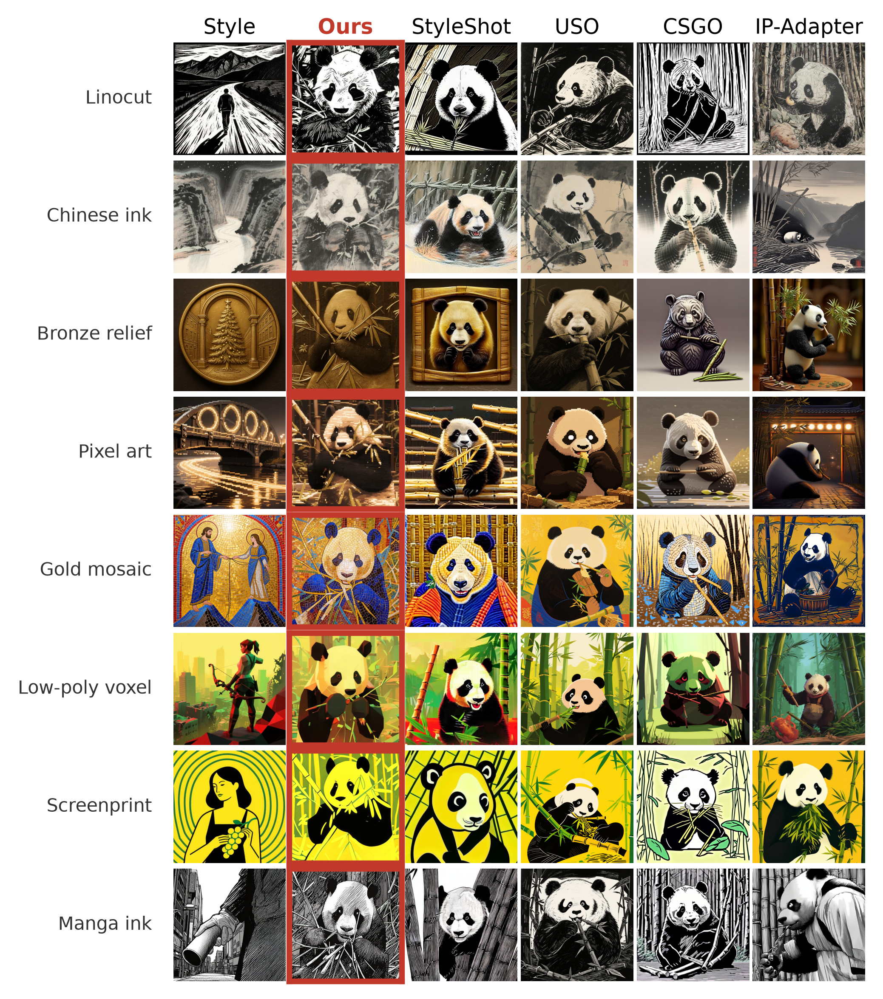
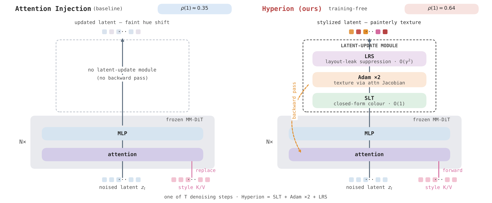
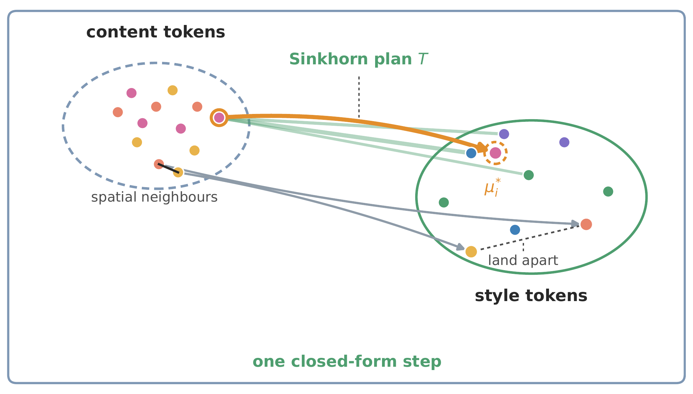
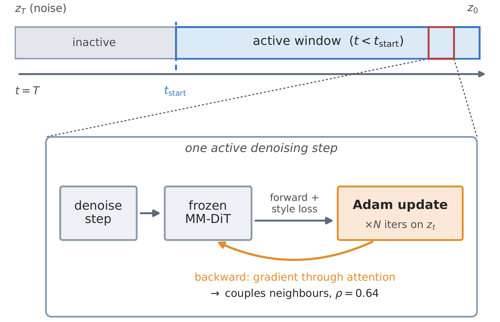
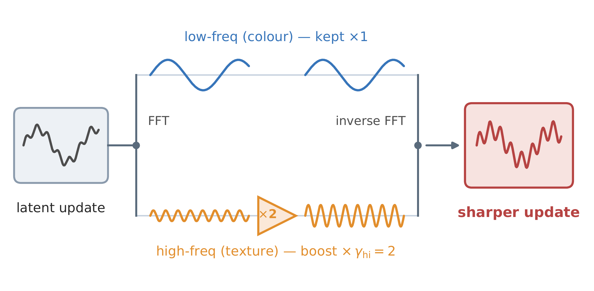
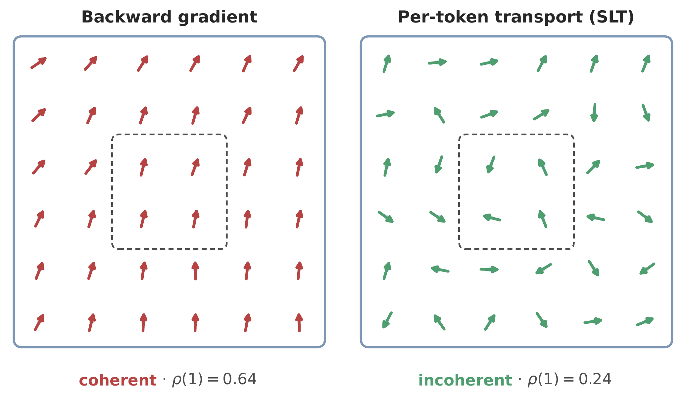
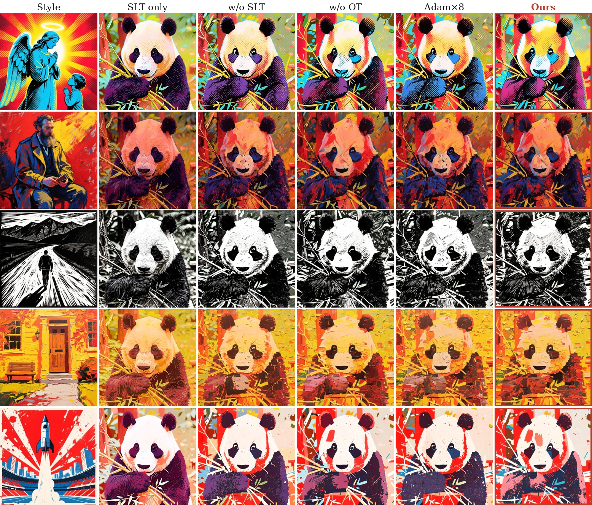
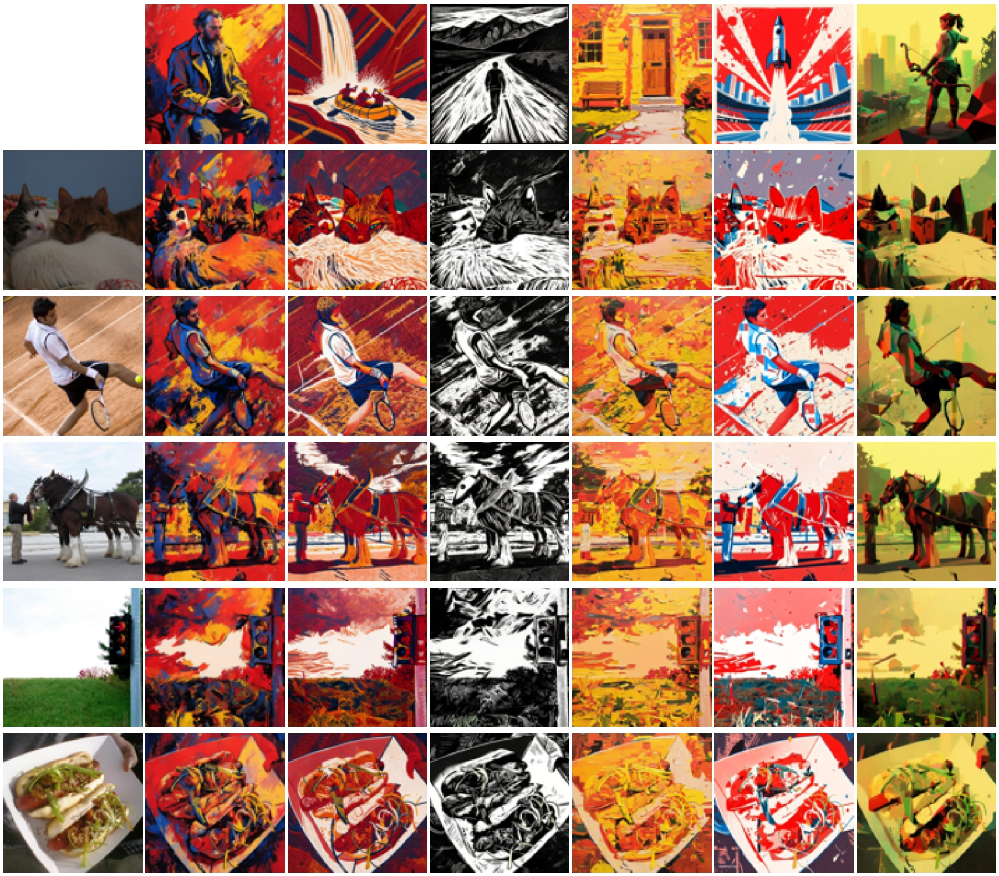
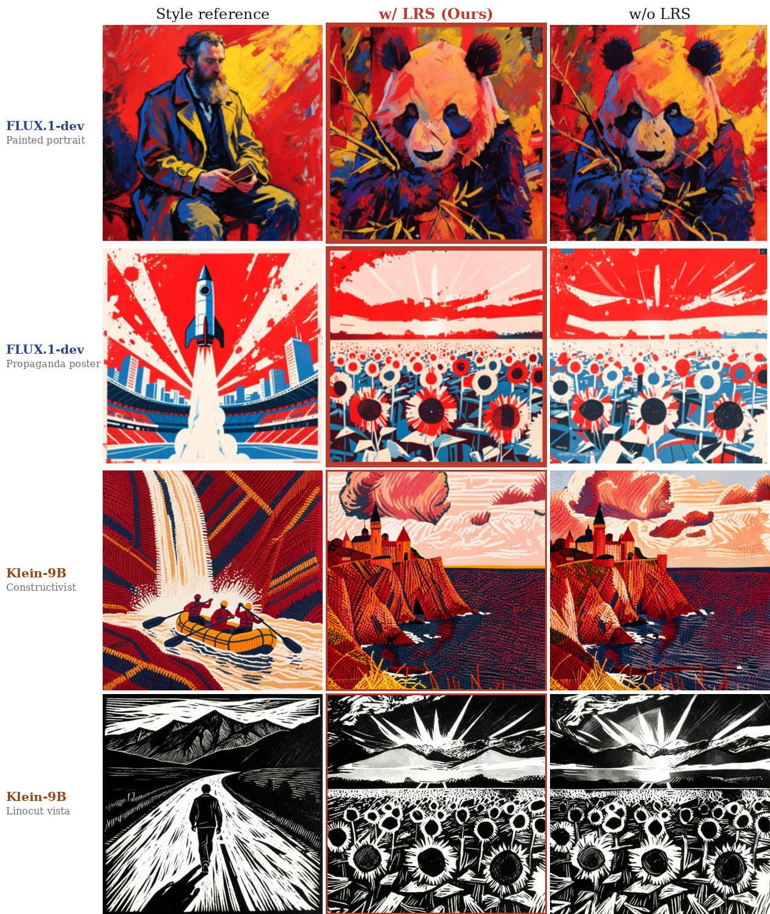
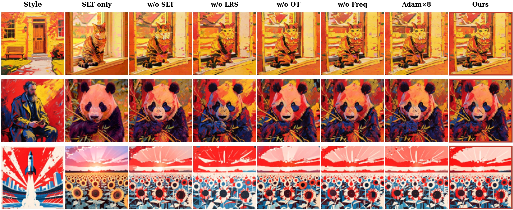

# Bridging the Training Gap with Hyperion: A Training-Free Style Transfer Method on Diffusion Transformers

<div align="center">

[](https://jackeyloveseven.github.io/hyperion/)
[](https://github.com/jackeyloveseven/hyperion-style-transfer)
[](https://github.com/jackeyloveseven/hyperion)
[](LICENSE)
[](https://www.python.org/)
[](https://pytorch.org/)

**IEEE Transactions on Pattern Analysis and Machine Intelligence (TPAMI) 2026**

[English](README.md) | [中文说明](README_CN.md) | [Project Page](https://jackeyloveseven.github.io/hyperion/)

</div>

---

## 🎨 Gallery


*Hyperion generates expressive, high-fidelity brushstroke textures and authentic painterly medium characteristics across watercolor, oil impasto, sketch, linocut, and ink wash styles — entirely training-free with zero fine-tuned weights.*

---

## 📖 Table of Contents

- [Overview](#-overview)
- [Method & Architecture](#-method--architecture)
- [Quantitative Results](#-quantitative-results)
- [Qualitative Results](#-qualitative-results)
- [Unique Quantitative Metrics](#-unique-quantitative-metrics)
- [Repository Structure](#-repository-structure)
- [Installation](#-installation)
- [Quickstart & CLI](#-quickstart--cli)
  - [1. Text-to-Image (T2I) Style Transfer](#1-text-to-image-t2i-style-transfer)
  - [2. Image-to-Image (I2I) Style Transfer](#2-image-to-image-i2i-style-transfer)
  - [3. Quantitative Metrics Evaluation](#3-quantitative-metrics-evaluation)
- [Python API Usage](#-python-api-usage)
- [Hyperparameters & Reproducibility](#-hyperparameters--reproducibility)
- [BibTeX Citation](#-bibtex-citation)
- [License](#-license)

---

## 🌟 Overview

Training-free style transfer on Multimodal Diffusion Transformers (MM-DiT) has historically suffered from a fundamental performance gap compared to trained adapters (e.g. CSGO, USO, StyleShot): forward-injection methods produce only faint hue shifts without rich painterly textures.

**Hyperion** traces this limitation to the absence of backpropagation-induced spatial coupling and proposes a fully training-free style transfer pipeline built on two synergistic components:

1. **Adam-in-loop Latent Optimization**: Backpropagates style loss gradients through the frozen MM-DiT at each denoising step, recovering the self-attention value-path spatial coupling ($\rho = 0.64$) responsible for expressive brushstrokes.
2. **Sinkhorn Latent Transport (SLT)**: A closed-form entropic optimal transport step that pre-aligns latent color and distribution statistics in $\approx 0.1\text{ ms}$ with **zero forward passes**, eliminating gradient budget waste on low-frequency color convergence.

On our 234-pair benchmark (39 styles $\times$ 6 prompts), Hyperion outperforms equal-budget Adam-only baselines by **+16.6% CSD** and prior training-free methods by **+5.2%**, beating four trained adapters on **19 of 21** diverse style families.

---

## 🔬 Method & Architecture



Built on frozen MM-DiT backbones (primarily **FLUX.2-Klein-9B** and **FLUX.1-dev**), Hyperion introduces four tightly coupled components:

| Component | Role | Physical / Mathematical Mechanism |
|---|---|---|
| **Sinkhorn Latent Transport (SLT)** | Zero-shot color & distribution pre-alignment | Computes token-level optimal transport plan $T = \text{Sinkhorn}(\tilde{S}/\tau)$ from high-pass residual cosine similarities and aligns latents via per-token **OT-AdaIN** in $\approx 0.1\text{ ms}$ with 0 neural forward passes. |
| **Adam-in-loop Latent Optimization** | Recovers brushstroke spatial coupling | Backpropagates through frozen MM-DiT self-attention value paths ($\rho = 0.64$), forcing neighboring latent tokens to undergo correlated gradient updates. |
| **Frequency-Domain Sinkhorn Attention** | High-frequency detail & texture boost | Decomposes attention logits into low and high frequencies ($\text{logits} = \text{logits}_\text{lo} + \gamma_\text{hi} \text{logits}_\text{hi}$, $\gamma_\text{hi}=2.0$) followed by doubly-stochastic Sinkhorn normalization. |
| **Layout Residual Suppression (LRS)** | Prevents reference layout leakage | Attenuates spatial layout residuals of style key/value tensors along network depth ($\gamma^{(\ell)}: 0.70 \to 0.50$), suppressing reference composition leakage. |

<div align="center">
<table>
  <tr>
    <td align="center"><br><b>Sinkhorn Latent Transport</b></td>
    <td align="center"><br><b>Adam-in-Loop Coupling</b></td>
    <td align="center"><br><b>Frequency Decomposition</b></td>
    <td align="center"><br><b>Layout Suppression</b></td>
  </tr>
</table>
</div>

---

## 📊 Quantitative Results

### 1. Main T2I Benchmark (234 Pairs: 39 Styles $\times$ 6 Prompts)

| Method | Type | CSD ↑ | CLIP-T ↑ | STM ↑ | Fwd. / Step |
|---|:---:|:---:|:---:|:---:|:---:|
| Text-only Baseline | Training-Free | -0.010 | 0.315 | 0.350 | 1 |
| Forward Injection | Training-Free | 0.039 | 0.314 | 0.395 | 2 |
| Adam-8 (no SLT) | Training-Free | 0.608 | 0.279 | 0.726 | 10 |
| SLT only (no Adam) | Training-Free | 0.298 | 0.309 | 0.624 | 2 |
| **Hyperion (Ours, $N=2$)** | **Training-Free** | **0.640** | **0.296** | **0.775** | **4** |

> **Key takeaway**: Hyperion achieves CSD = 0.640 with only 4 forward passes per step ($2.5\times$ fewer than Adam-8) while exceeding Adam-8's CSD by **+5.2%** and equal-budget Adam-only by **+16.6%**.

### 2. Image-to-Image (I2I) Comparison with Trained Adapters

| Method | Backbone | CSD ↑ | CLIP-I ↑ | LPIPS ↓ | FID ↓ | ArtFID ↓ | SCH ↑ | STM ↑ |
|---|:---:|:---:|:---:|:---:|:---:|:---:|:---:|:---:|
| CSGO | SDXL (Trained) | 0.557 | 0.689 | 0.656 | 15.1 | 26.7 | 0.619 | 0.363 |
| USO | FLUX (Trained) | 0.510 | **0.766** | 0.666 | 8.9 | 16.5 | 0.625 | 0.263 |
| IP-Adapter | FLUX (Trained) | 0.160 | 0.623 | **0.558** | 17.0 | 28.0 | 0.316 | 0.465 |
| Qwen-Image-Edit | Qwen (Trained) | 0.343 | 0.708 | 0.663 | 7.5 | 14.1 | 0.493 | 0.405 |
| **Hyperion (Ours)** | **MM-DiT (Frozen)** | **0.712** | 0.660 | 0.696 | **5.4** | **10.9** | **0.686** | **0.716** |

### 3. Component Ablation Study

| Configuration | CSD ↑ | CLIP-T ↑ | STM ↑ | Fwd. Passes | Wall Time ↓ |
|---|:---:|:---:|:---:|:---:|:---:|
| **Hyperion (Full, $N=2$)** | **0.681** | 0.274 | **0.775** | 4 | 6.4 s |
| Without SLT (Adam-2 only) | 0.584 | 0.291 | 0.697 | 4 | 6.4 s |
| Without Adam (SLT only) | 0.298 | 0.309 | 0.624 | 2 | 2.2 s |
| Softmax Attention Target | 0.633 | 0.283 | 0.735 | 4 | 6.4 s |
| Without Frequency Boost | 0.678 | 0.271 | 0.773 | 4 | 6.4 s |
| Adam-8 (Upper Bound Baseline) | 0.650 | 0.296 | 0.726 | 10 | 19.0 s |

---

## 🖼️ Qualitative Results

### Text-to-Image (T2I) Qualitative Benchmark Comparison


### Image-to-Image (I2I) Qualitative Benchmark Comparison


### Layout Residual Suppression (LRS) Anti-Leakage Demo


### Component Ablation Visual Comparison


---

## 📈 Unique Quantitative Metrics

This repository open-sources all novel evaluation metrics introduced in the TPAMI paper:

| Metric | Function / Module | Description | Direction |
|---|---|---|---|
| **STM** | `compute_style_texture_match` | **Style-Texture Match**: Pearson correlation between mean-centered orientation histograms of high-pass residuals (tracks CSD at $r=+0.98$, discriminates across trained and training-free methods). | $\uparrow$ (Higher is better) |
| **Tex. Energy** | `compute_texture_energy` | Mean absolute high-pass residual quantifying brushstroke and texture presence. | $\uparrow$ |
| **Orient. Coh.** | `compute_orientation_coherence` | Structure tensor eigenvalue ratio $\frac{\lambda_1 - \lambda_2}{\lambda_1 + \lambda_2 + \epsilon}$ weighted by gradient trace, quantifying streamline coherence. | $\uparrow$ |
| **SCH** | `compute_style_content_harmonic` | **Style-Content Harmonic**: $\mathrm{SCH} = \sqrt{\mathrm{CSD} \cdot \mathrm{CLIP\text{-}I}}$, balancing style transfer and content retention. | $\uparrow$ |
| **Layout Leakage** | `compute_layout_leakage_from_patches` | DINOv2 patch self-similarity correlation diagnosing reference subject layout leakage. | $\downarrow$ (Lower is better) |
| **$\rho(d)$** | `compute_spatial_neighbor_correlation` | Update-space neighbor cosine correlation diagnosing spatial gradient coupling. | Diagnostic ($\approx 0.64$) |

---

## 📁 Repository Structure

```
hyperion/
├── hyperion/                     # Core Python Package
│   ├── core/                     # Algorithmic & mathematical primitives
│   │   ├── sinkhorn.py           # Sinkhorn-Knopp normalization & OT attention
│   │   ├── slt.py                # Sinkhorn Latent Transport (SLT, OT-AdaIN)
│   │   ├── lrs.py                # Layout Residual Suppression (LRS)
│   │   ├── loss.py               # HyperionLoss & frequency-domain loss
│   │   └── color.py              # Feature AdaIN & terminal 1-D color correction
│   ├── models/                   # Transformer integrations & hooks
│   │   ├── hooks.py              # AttentionCache & AttentionController
│   │   ├── klein9b.py            # Klein 9B (DiffSynth MM-DiT) attention hooks
│   │   └── flux.py               # FLUX.1-dev / Kontext (diffusers) hooks
│   ├── pipeline/                 # High-level pipeline API
│   │   ├── config.py             # HyperionConfig dataclass (TPAMI Table 10)
│   │   └── hyperion_pipeline.py  # HyperionPipeline (T2I & I2I inference)
│   └── metrics/                  # Open-sourced evaluation metrics
│       ├── stm.py                # Style-Texture Match (STM)
│       ├── texture.py            # Texture energy & orientation coherence
│       ├── sch.py                # Style-Content Harmonic (SCH)
│       ├── layout_leakage.py     # DINO layout leakage
│       ├── spatial_coherence.py  # Spatial neighbor correlation rho(d)
│       ├── perceptual.py         # DINO-style, Gram distance, ArtFID
│       ├── csd.py                # Contrastive Style Descriptor wrapper
│       └── clip_eval.py          # CLIP-T & CLIP-I alignment
├── images/                       # High-resolution benchmark & paper figures
├── scripts/                      # CLI entrypoints
│   ├── generate_t2i.py           # Standalone T2I generation
│   ├── generate_i2i.py           # Standalone I2I generation
│   ├── evaluate_metrics.py       # Comprehensive metric evaluation runner
│   └── download_models.py        # Model download assistant
├── configs/                      # Canonical JSON configurations
│   ├── tpami_t2i_default.json    # Canonical T2I settings
│   └── tpami_i2i_default.json    # Canonical I2I settings
├── tests/                        # Comprehensive unit test suite (54 tests)
├── index.html                    # Academic Project Website (GitHub Pages)
├── pyproject.toml                # Packaging metadata
├── requirements.txt              # Production dependencies
└── LICENSE                       # Apache 2.0 License
```

---

## ⚙️ Installation

### 1. Clone repository & install dependencies
```bash
git clone https://github.com/jackeyloveseven/hyperion.git
cd hyperion

python -m venv .venv
# Linux / macOS:
source .venv/bin/activate
# Windows:
.venv\Scripts\activate

pip install -r requirements.txt
pip install -e .
```

### 2. Download Model Checkpoints
Hyperion operates on frozen MM-DiT backbones (primarily **FLUX.2-Klein-9B** or **FLUX.1-dev**):
```bash
# Download backbone and metric models
python scripts/download_models.py --target all
```

### 3. Run Unit Tests
Verify mathematical algorithms, metrics, attention controllers, and pipeline logic:
```bash
python -m unittest discover -s tests -v
```

---

## 🚀 Quickstart & CLI

### 1. Text-to-Image (T2I) Style Transfer
```bash
python scripts/generate_t2i.py \
    --prompt "A sports car on a mountain road" \
    --style assets/style_example.png \
    --output outputs/car_stylized.png \
    --steps 25 \
    --seed 43
```

### 2. Image-to-Image (I2I) Style Transfer
Preserves content layout via in-context token concatenation while transferring style:
```bash
python scripts/generate_i2i.py \
    --content assets/content_example.png \
    --style assets/style_example.png \
    --prompt "masterpiece" \
    --output outputs/i2i_stylized.png \
    --steps 25 \
    --seed 43
```

### 3. Quantitative Metrics Evaluation
Evaluate your generated image with Hyperion's unique metrics:
```bash
python scripts/evaluate_metrics.py \
    --output outputs/car_stylized.png \
    --style assets/style_example.png \
    --prompt "A sports car on a mountain road" \
    --save_csv results.csv
```

---

## 🐍 Python API Usage

```python
import torch
from PIL import Image
from hyperion import HyperionPipeline, HyperionConfig
from hyperion.metrics import compute_style_texture_match, compute_texture_energy

# 1. Load pipeline
pipe = HyperionPipeline.from_pretrained_klein9b("models/klein9b", device="cuda")

# 2. Configure with TPAMI defaults
config = HyperionConfig.t2i_default(
    num_inference_steps=25,
    guidance_scale=3.5,
    seed=43,
)

# 3. Generate
output = pipe.generate_t2i(
    prompt="A cat sitting on a wooden table",
    style_image="path/to/style.png",
    config=config,
)
output.save("cat_stylized.png")

# 4. Compute unique style metrics
stm_score = compute_style_texture_match(output, "path/to/style.png")
energy = compute_texture_energy(output)
print(f"Style-Texture Match (STM): {stm_score:.4f}")
print(f"Texture Energy: {energy:.4f}")
```

---

## 📋 Hyperparameters & Reproducibility

Canonical hyperparameters from **Table 10** in the TPAMI publication:

| Parameter | T2I Setting | I2I Setting | Description |
|---|---|---|---|
| Backbone | Klein 9B (FLUX.2) | Klein 9B (FLUX.2) | Frozen MM-DiT architecture |
| Denoising Steps | 25 | 25 | Flow-matching schedule |
| Guidance Scale | 3.5 | 3.5 | Classifier-free guidance |
| Active Window $t_\text{start}$ | 850 | 870 | Denoising steps with active style optimization |
| SLT $\alpha$ | 0.10 | 0.10 | Latent transport interpolation weight |
| SLT $\tau_\text{SLT}$ | 0.02 | 0.02 | Sinkhorn temperature for transport plan |
| Adam Iterations $N$ | 2 | 2 | In-loop backprop iterations per active step |
| Adam Learning Rate | 0.03 | 0.03 | Latent optimizer learning rate |
| Style Weight $w_s$ | 2.0 | 2.0 | Multi-layer attention matching weight |
| Content Weight $w_c$ | 1.5 | 1.5 | Latent anchor drift resistance weight |
| Frequency Boost $\gamma_\text{hi}$ | 2.0 | 2.0 | High-frequency residual boost coefficient |
| LRS Schedule $\gamma^{(\ell)}$ | $0.70 \to 0.50$ | $0.70 \to 0.50$ | Depth-dependent layout attenuation |
| AdaIN Warm-Start $\alpha_w$ | 0.50 | 0.30 | Per-step statistics pre-alignment |
| Terminal 1-D Correction | Enabled | Enabled | Global per-channel color alignment |

---

## 📝 BibTeX Citation

If you find Hyperion or our evaluation metrics useful in your research, please cite:

```bibtex
@article{li2026bridging,
  title     = {Bridging the Training Gap with Hyperion: A Training-Free Style Transfer Method on Diffusion Transformers},
  author    = {Li, Yi and Li, Chengyan and Fang, Zhirui and Zhang, Junchuan and Wang, Xuan and Huang, Huaibo and Luo, Yan and Guo, Yanqing},
  journal   = {IEEE Transactions on Pattern Analysis and Machine Intelligence (TPAMI)},
  year      = {2026}
}
```

---

## 📄 License

This project is licensed under the Apache 2.0 License - see the [LICENSE](LICENSE) file for details.
