# Bridging the Training Gap with Hyperion: 基于扩散 Transformer 的免训练风格迁移方法

<div align="center">

[](https://jackeyloveseven.github.io/hyperion/)
[](https://github.com/jackeyloveseven/hyperion-style-transfer)
[](https://github.com/jackeyloveseven/hyperion-style-transfer/blob/main/main.pdf)
[](https://github.com/jackeyloveseven/hyperion-style-transfer/blob/main/supplementary.pdf)
[](https://github.com/jackeyloveseven/hyperion)
[](LICENSE)
[](https://www.python.org/)
[](https://pytorch.org/)

**IEEE Transactions on Pattern Analysis and Machine Intelligence (TPAMI) 2026**

[李毅](https://github.com/jackeyloveseven)<sup>1</sup>, [李承炎](https://github.com/jackeyloveseven)<sup>1</sup>, 房智锐<sup>1</sup>, 张俊川<sup>1</sup>, 王轩<sup>2</sup>, 黄淮波<sup>3</sup>, 罗艳<sup>1</sup>, 郭艳卿<sup>1,*</sup>

<sup>1</sup>大连理工大学 &nbsp;&bull;&nbsp; <sup>2</sup>北京航空航天大学 &nbsp;&bull;&nbsp; <sup>3</sup>中国科学院自动化研究所 (CASIA)  
<sup>*</sup>通讯作者 (Corresponding author)

[English](README.md) | [中文说明](README_CN.md) | [Project Page](https://jackeyloveseven.github.io/hyperion/)

</div>

---

## 📢 最新动态 (News)

- **[2026.11]** Hyperion 论文已被人工智能顶刊 **IEEE TPAMI 2026** 正式录用！🎉
- **[2026.11]** 正式发布整洁规范的代码工程、[学术项目主页 (Project Website)](https://jackeyloveseven.github.io/hyperion/)、完整的独特评价指标体系与基准快速复现物料！
- **[2026.07]** 论文正文初稿（18页）与包含 44 项可信溯源档案的补充材料（21页）已在 [hyperion-style-transfer](https://github.com/jackeyloveseven/hyperion-style-transfer) 开源发布。

---

## 🎨 视觉效果展示

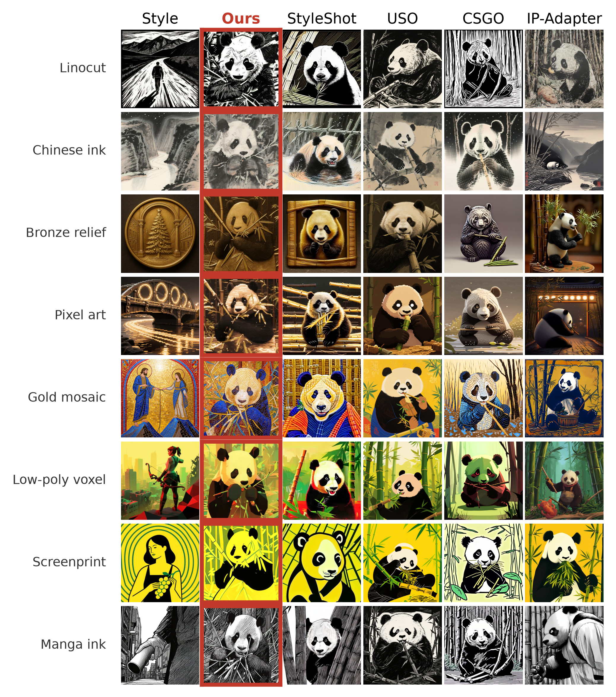
*Hyperion 能够生成极具表现力、高保真度的真实画笔笔触纹理与真实的艺术媒介特征（涵盖水彩、油画厚涂、素描线描、版画刻印、水墨等），且全程完全免训练，不微调任何主干权重。*

---

## 📖 目录

- [📢 最新动态 (News)](#-最新动态-news)
- [🎨 视觉效果展示](#-视觉效果展示)
- [🌟 核心概述](#-核心概述)
- [🔬 方法与算法架构](#-方法与算法架构)
- [📊 定量实验结果](#-定量实验结果)
- [🖼️ 定性对比展示](#️-定性对比展示)
- [📈 本文开源的独特指标体系](#-本文开源的独特指标体系)
- [📁 仓库目录结构](#-仓库目录结构)
- [⚙️ 环境依赖与安装](#️-环境依赖与安装)
- [🚀 命令行快速上手](#-命令行快速上手)
  - [1. 文生图风格迁移（T2I）](#1-文生图风格迁移t2i)
  - [2. 图生图风格迁移（I2I）](#2-图生图风格迁移i2i)
  - [3. 指标计算与评估](#3-指标计算与评估)
- [🐍 Python API 使用指南](#-python-api-使用指南)
- [📋 超参数与复现配置](#-超参数与复现配置)
- [📝 引用格式 (BibTeX)](#-引用格式-bibtex)
- [📄 开源协议](#-开源协议)

---

## 🌟 核心概述

在多模态扩散 Transformer（MM-DiT）架构上，传统的免训练（Training-Free）风格迁移主要采用前向特征注入（Forward Feature Injection），容易出现仅能改变浅层色调、无法生成真实画笔笔触纹理（brushstrokes）的问题；而已有的训练式适配器（如 CSGO、USO、StyleShot）虽然具有较强风格，但需要昂贵的微调训练，且存在内容崩塌的风险。

**Hyperion** 首次指出这一局限源于**缺乏反向传播引发的空间梯度耦合**，并提出了一套全程冻结网络权重的免训练风格迁移架构：

1. **Adam-in-loop 潜空间梯度优化**：在去噪每一步通过冻结的 MM-DiT 进行反向传播优化 latent，恢复自注意力 Value 路径的空间耦合能力（邻域相关度 $\rho = 0.64$），从而生成连贯、真实的笔触与纹理。
2. **Sinkhorn Latent Transport (SLT) 最优传输预对齐**：在每步去噪前，利用高频残差余弦相似度构建闭式最优传输（OT）矩阵，通过 OT-AdaIN 一次性对齐 latent 颜色与多阶统计量（耗时仅约 $0.1\text{ ms}$，**0 次额外前向计算**），免除早期 Adam 迭代浪费在低频色彩校正上的梯度预算。

在完整的 234 对评测基准（39 种风格 $\times$ 6 组提示词）上，Hyperion 相比同算力预算的纯 Adam 基线提升 **+16.6% CSD**，相比前序免训练方法提升 **+5.2%**，并在 **19/21** 个风格大类上全面超越主流训练式适配器。

---

## 🔬 方法与算法架构

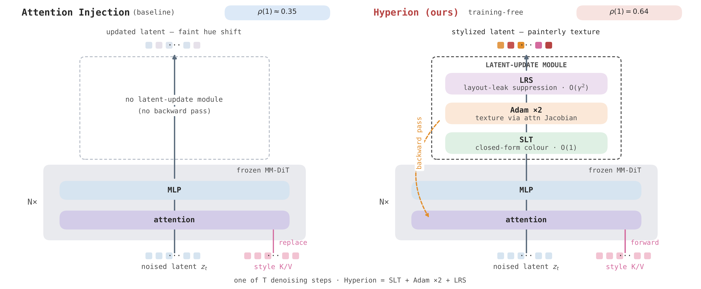

Hyperion 运行于冻结的 MM-DiT 主干（如 **FLUX.2-Klein-9B** 或 **FLUX.1-dev**）之上，包含四大核心模块：

| 模块名称 | 作用 | 物理机理与数学表达 |
|---|---|---|
| **Sinkhorn Latent Transport (SLT)** | 零额外前向计算的色彩分布预对齐 | 基于高频残差余弦相似度计算最优传输方案 $T = \text{Sinkhorn}(\tilde{S}/\tau)$，通过 **OT-AdaIN** 一步完成分布对齐（$\approx 0.1\text{ ms}$，0 次网络前向），避免 Adam 梯度浪费在全局调色上。 |
| **Adam-in-loop 潜空间优化** | 恢复真实画笔笔触空间相干性 | 通过冻结的 MM-DiT 反向传播风格自注意力损失，恢复自注意力 Value 路径空间梯度耦合（$\rho = 0.64$），驱动相邻 token 协同更新形成流线型笔触。 |
| **频域 Sinkhorn 损失** | 高频纹理细节增强 | 将自注意力 Query 与 Key 分解为低频与高频分量（$\text{logits} = \text{logits}_\text{lo} + \gamma_\text{hi} \text{logits}_\text{hi}$，$\gamma_\text{hi}=2.0$），通过双随机 Sinkhorn 归一化大幅抑制纹理平滑。 |
| **布局残差抑制 (LRS)** | 防止风格参考图构图外溢 | 沿网络深度对风格参考图的 Key/Value 进行渐进空间残差衰减（$\gamma^{(\ell)}: 0.70 \to 0.50$），阻断风格图主体结构对生成内容的污染（Anti-Layout-Leakage）。 |

<div align="center">
<table>
  <tr>
    <td align="center">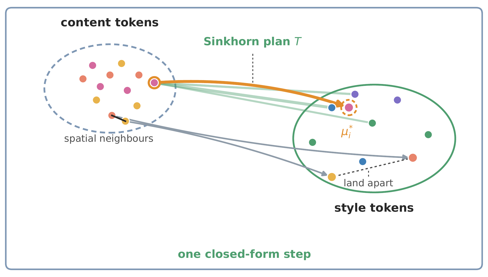<br><b>最优传输预对齐 (SLT)</b></td>
    <td align="center">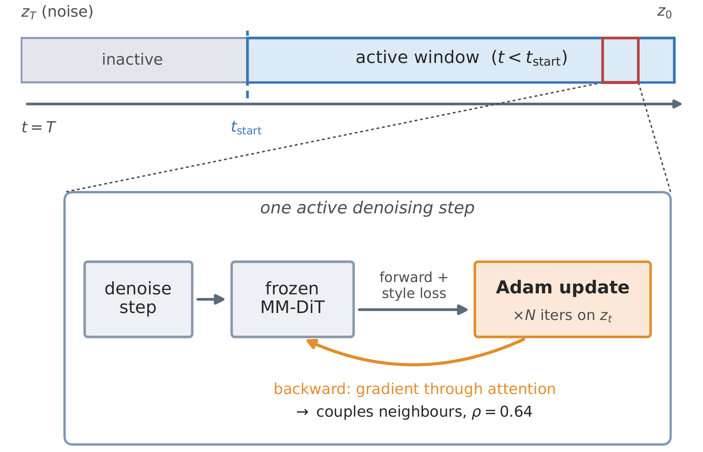<br><b>Adam 梯度空间耦合</b></td>
    <td align="center">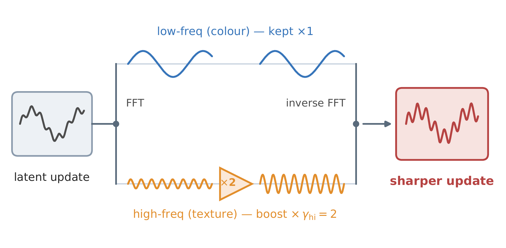<br><b>频域损失细节增强</b></td>
    <td align="center">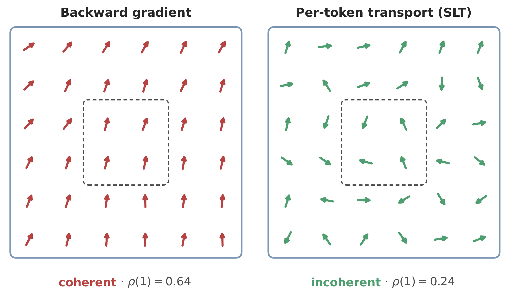<br><b>布局残差衰减 (LRS)</b></td>
  </tr>
  <tr>
    <td colspan="2" align="center">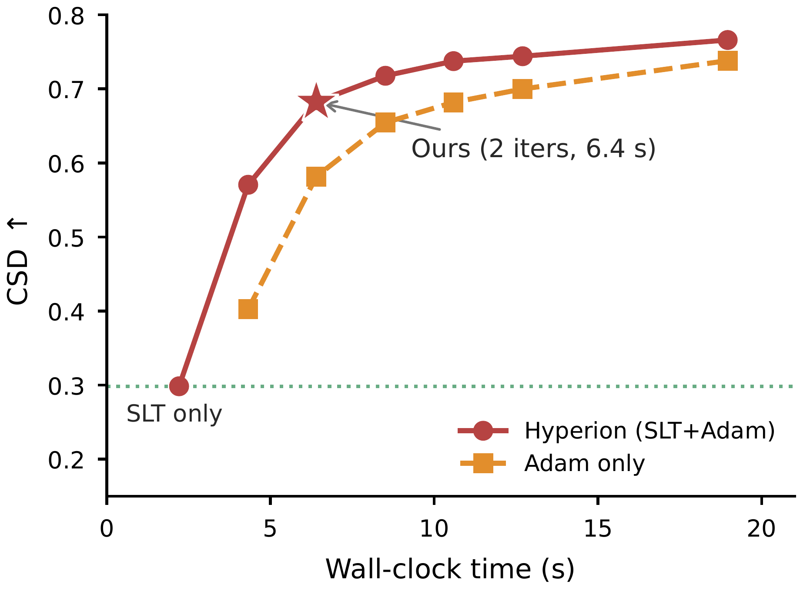<br><b>风格-内容 Pareto 前沿对比</b></td>
    <td colspan="2" align="center">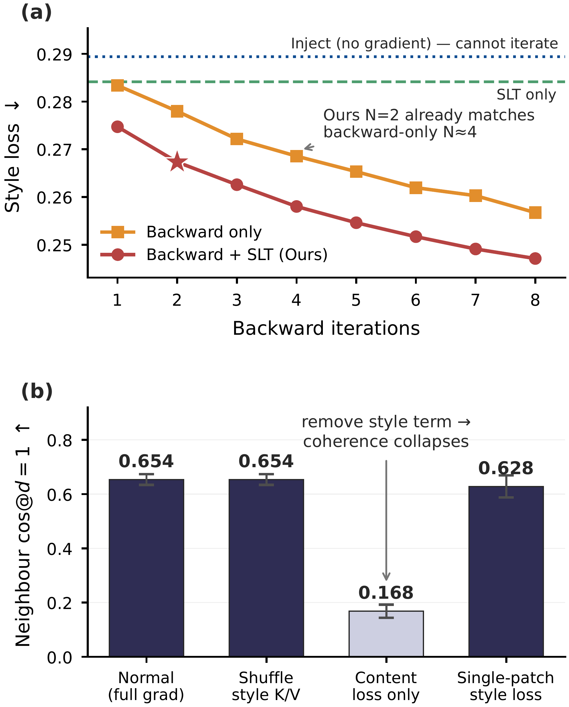<br><b>空间梯度耦合度 &rho;(d) 理论与实验验证</b></td>
  </tr>
</table>
</div>

---

## 📊 定量实验结果

### 1. 主文生图 (T2I) 基准对比 (234 对样本: 39 风格 $\times$ 6 提示词)

| 方法 | 类型 | CSD ↑ | CLIP-T ↑ | STM ↑ | 单步前向次数 |
|---|:---:|:---:|:---:|:---:|:---:|
| 纯文本基线 (Text-only) | 免训练 | -0.010 | 0.315 | 0.350 | 1 |
| 前向特征注入 (Inject) | 免训练 | 0.039 | 0.314 | 0.395 | 2 |
| Adam-8 (无 SLT) | 免训练 | 0.608 | 0.279 | 0.726 | 10 |
| SLT only (无 Adam) | 免训练 | 0.298 | 0.309 | 0.624 | 2 |
| **Hyperion (本文方法, $N=2$)** | **免训练** | **0.640** | **0.296** | **0.775** | **4** |

> **核心结论**：Hyperion 仅需单步 4 次前向（比 Adam-8 减少 **2.5 倍**），CSD 反超 Adam-8 **+5.2%**，在等量计算预算下更超出纯 Adam **+16.6%**。

### 2. 图生图 (I2I) 与主流训练式适配器全面对比

| 方法 | 主干与属性 | CSD ↑ | CLIP-I ↑ | LPIPS ↓ | FID ↓ | ArtFID ↓ | SCH ↑ | STM ↑ |
|---|:---:|:---:|:---:|:---:|:---:|:---:|:---:|:---:|
| CSGO | SDXL (微调适配器) | 0.557 | 0.689 | 0.656 | 15.1 | 26.7 | 0.619 | 0.363 |
| USO | FLUX (微调适配器) | 0.510 | **0.766** | 0.666 | 8.9 | 16.5 | 0.625 | 0.263 |
| IP-Adapter | FLUX (微调适配器) | 0.160 | 0.623 | **0.558** | 17.0 | 28.0 | 0.316 | 0.465 |
| Qwen-Image-Edit | Qwen (指令微调) | 0.343 | 0.708 | 0.663 | 7.5 | 14.1 | 0.493 | 0.405 |
| **Hyperion (本文方法)** | **MM-DiT (全程冻结)** | **0.712** | 0.660 | 0.696 | **5.4** | **10.9** | **0.686** | **0.716** |

### 3. 消融实验定量验证

| 配置方案 | CSD ↑ | CLIP-T ↑ | STM ↑ | 前向次数 | 单图耗时 ↓ |
|---|:---:|:---:|:---:|:---:|:---:|
| **Hyperion 完整方法 ($N=2$)** | **0.681** | 0.274 | **0.775** | 4 | 6.4 s |
| 去除 SLT (仅 Adam-2) | 0.584 | 0.291 | 0.697 | 4 | 6.4 s |
| 去除 Adam (仅 SLT) | 0.298 | 0.309 | 0.624 | 2 | 2.2 s |
| 传统 Softmax 注意力目标 | 0.633 | 0.283 | 0.735 | 4 | 6.4 s |
| 去除频域高频增强 | 0.678 | 0.271 | 0.773 | 4 | 6.4 s |
| Adam-8 (算力上限参考) | 0.650 | 0.296 | 0.726 | 10 | 19.0 s |

---

## 🖼️ 定性对比展示

### 234 对全量基准大图定性对比
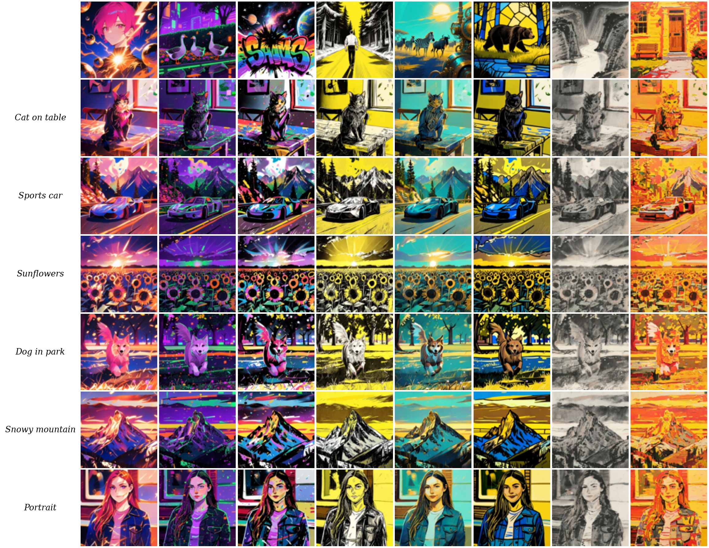
*在涵盖 21 个不同艺术流派的基准上，与四种主流前沿风格化方法（CSGO、USO、IP-Adapter、Qwen）的定性对比展示。*

### 文生图 (T2I) 生成效果对比
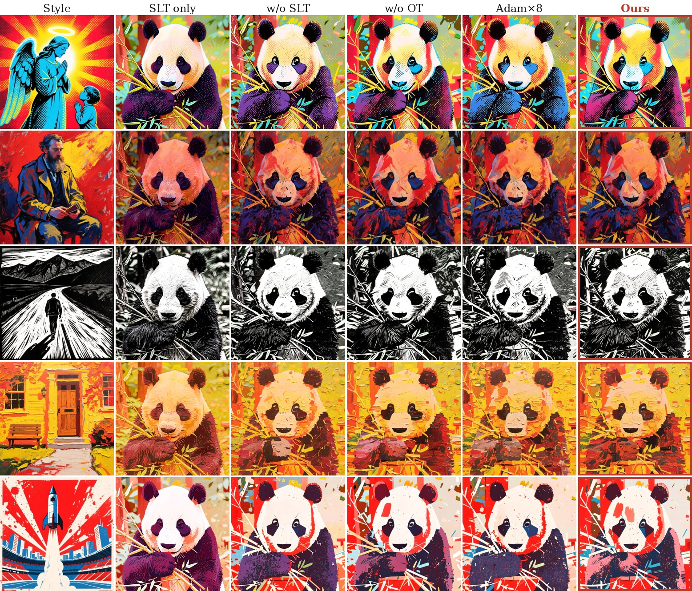

### 图生图 (I2I) 生成效果对比
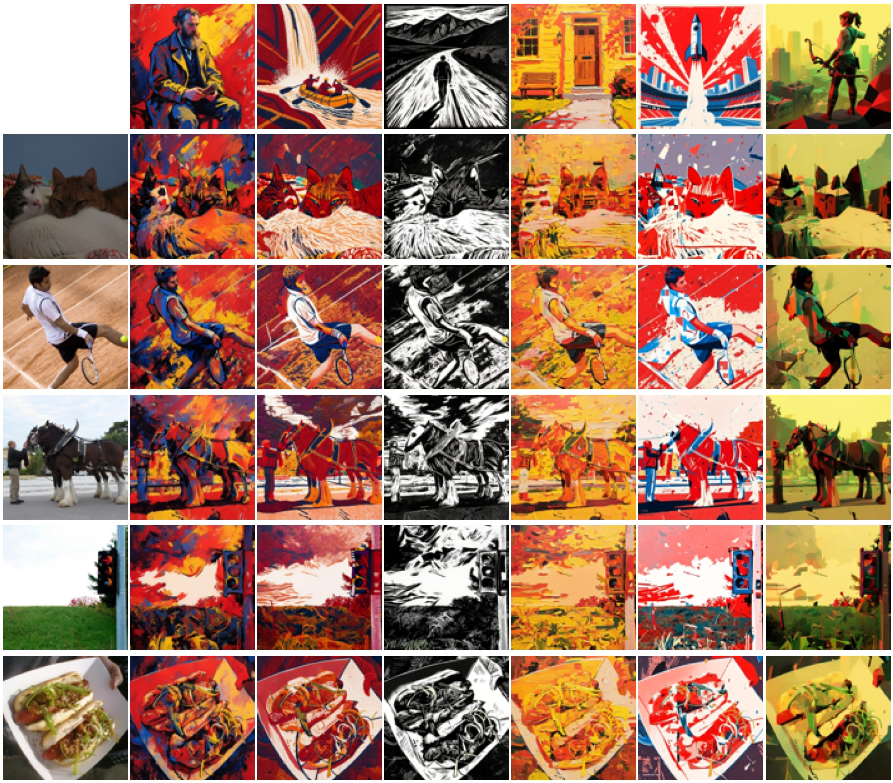

### 布局残差抑制 (LRS) 防构图泄露对比
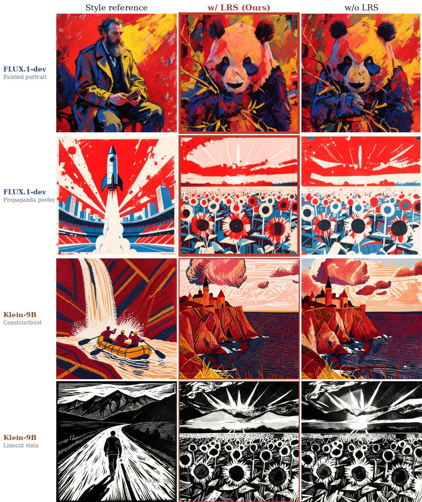

### 模块消融定性对比
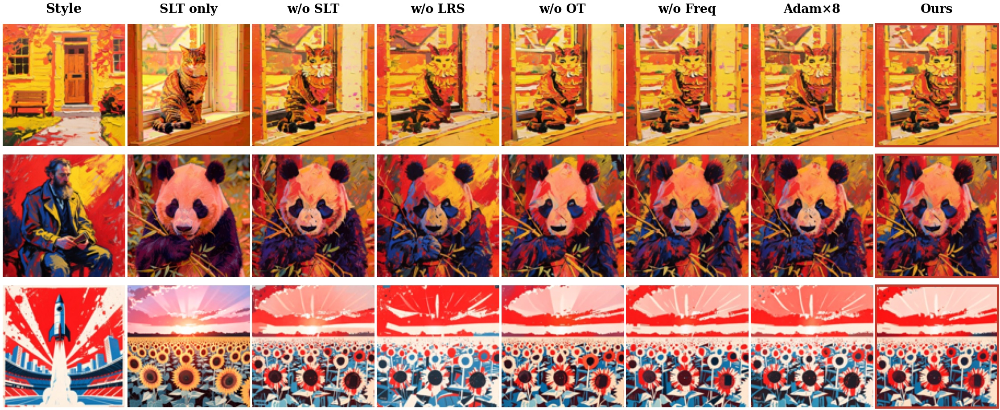

### 234 对评测基准风格图谱 (39 种风格 &times; 6 组提示词)
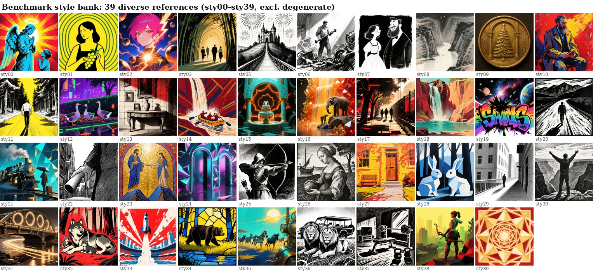
*论文采用的标准基准图谱，全面覆盖印象派、厚涂油画、水彩、浮世绘、线描素描、版画刻印、水墨流线等 21 个艺术媒介家族。*

---

## 📈 本文开源的独特指标体系

本仓库完整开源了 IEEE TPAMI 论文中提出的所有独特量化评估指标实现：

| 指标名称 | Python 函数 | 作用与物理含义 | 优劣方向 |
|---|---|---|---|
| **STM** | `compute_style_texture_match` | **风格纹理匹配度**：高频残差方向梯度的去中心化直方图余弦相关性，与 CSD 皮尔逊相关系数高达 $+0.98$。 | $\uparrow$ 越大越好 |
| **Tex. Energy** | `compute_texture_energy` | **纹理能量**：高频残差绝对均值，衡量画面厚涂感与纹理丰富度。 | $\uparrow$ 越大越好 |
| **Orient. Coh.** | `compute_orientation_coherence` | **方向相干性**：结构张量特征值比率，衡量笔触是否沿流线方向连贯排列。 | $\uparrow$ 越大越好 |
| **SCH** | `compute_style_content_harmonic` | **风格-内容调和均值**：$\mathrm{SCH} = \sqrt{\mathrm{CSD} \cdot \mathrm{CLIP\text{-}I}}$，平衡风格化强度与内容保真度。 | $\uparrow$ 越大越好 |
| **Layout Leakage** | `compute_layout_leakage_from_patches` | **DINO 布局泄露率**：DINOv2 patch 空间自相似性皮尔逊相关系数，量化风格图构图对生成内容的污染。 | $\downarrow$ 越小越好 |
| **$\rho(d)$** | `compute_spatial_neighbor_correlation` | **潜空间更新相干度**：衡量梯度在相邻 token 间的耦合强度（证明 Adam-in-loop 笔触机理的关键指标）。 | 诊断参考（$\approx 0.64$） |

---

## 📁 仓库目录结构

```
hyperion/
├── hyperion/                     # 核心 Python 算法库
│   ├── core/                     # 算法与数学核心算子
│   │   ├── sinkhorn.py           # Sinkhorn-Knopp 归一化与最优传输注意力
│   │   ├── slt.py                # Sinkhorn Latent Transport (SLT, OT-AdaIN)
│   │   ├── lrs.py                # 布局残差抑制 (LRS)
│   │   ├── loss.py               # HyperionLoss 与频域风格损失
│   │   └── color.py              # 特征 AdaIN 与末端 1D 色彩校正
│   ├── models/                   # Transformer 适配与 Hook 控制器
│   │   ├── hooks.py              # AttentionCache 与 AttentionController
│   │   ├── klein9b.py            # Klein 9B (DiffSynth MM-DiT) 注意力 Hook
│   │   └── flux.py               # FLUX.1-dev / Kontext (diffusers) Hook
│   ├── pipeline/                 # 顶层推理管线 API
│   │   ├── config.py             # HyperionConfig 配置类 (TPAMI Table 10)
│   │   └── hyperion_pipeline.py  # HyperionPipeline (T2I 与 I2I 推理引擎)
│   └── metrics/                  # 论文开源评测指标体系
│       ├── stm.py                # 风格纹理匹配度 (STM)
│       ├── texture.py            # 纹理能量与方向相干性
│       ├── sch.py                # 风格-内容调和均值 (SCH)
│       ├── layout_leakage.py     # DINO 布局泄露率
│       ├── spatial_coherence.py  # 潜空间更新相干度 rho(d)
│       ├── perceptual.py         # DINO 风格距离、Gram 矩阵、ArtFID
│       ├── csd.py                # CSD 特征提取封装
│       └── clip_eval.py          # CLIP-T / CLIP-I 计算
├── images/                       # 论文高清效果对比图与架构图
├── scripts/                      # 命令行执行脚本
│   ├── generate_t2i.py           # 独立文生图生成脚本
│   ├── generate_i2i.py           # 独立图生图生成脚本
│   ├── evaluate_metrics.py       # 论文指标一键综合评测脚本
│   └── download_models.py        # 权重辅助下载脚本
├── configs/                      # 论文标准配置文件
│   ├── tpami_t2i_default.json    # T2I 标准超参配置
│   └── tpami_i2i_default.json    # I2I 标准超参配置
├── tests/                        # 单元测试集 (54 项测试)
├── index.html                    # 顶会学术 Project Website (GitHub Pages)
├── pyproject.toml                # 现代化 Python 打包配置
├── requirements.txt              # 核心依赖清单
└── LICENSE                       # Apache 2.0 开源协议
```

---

## ⚙️ 环境依赖与安装

### 1. 克隆仓库并安装环境
```bash
git clone https://github.com/jackeyloveseven/hyperion.git
cd hyperion

python -m venv .venv
# Linux / macOS:
source .venv/bin/activate
# Windows:
.venv\Scripts\activate

pip install -r requirements.txt
pip install -e .
```

### 2. 权重下载
Hyperion 基于冻结的多模态扩散 Transformer（推荐 **FLUX.2-Klein-9B** 或 **FLUX.1-dev**）：
```bash
# 一键下载主干网络与评测模型
python scripts/download_models.py --target all
```

### 3. 运行单元测试
运行完整 54 项单元测试，验证所有数学算法、指标实现与推理流程：
```bash
python -m unittest discover -s tests -v
```

---

## 🚀 命令行快速上手

### 1. 文生图风格迁移（T2I）
```bash
python scripts/generate_t2i.py \
    --prompt "A sports car on a mountain road" \
    --style assets/style_example.png \
    --output outputs/car_stylized.png \
    --steps 25 \
    --seed 43
```

### 2. 图生图风格迁移（I2I）
```bash
python scripts/generate_i2i.py \
    --content assets/content_example.png \
    --style assets/style_example.png \
    --prompt "masterpiece" \
    --output outputs/i2i_stylized.png \
    --steps 25 \
    --seed 43
```

### 3. 指标计算与评估
一键评测您生成的图像（或使用我们预置的标准样图 `assets/output_example.png`）在本文创新指标体系下的表现：
```bash
python scripts/evaluate_metrics.py \
    --output assets/output_example.png \
    --style assets/style_example.png \
    --content assets/content_example.png \
    --prompt "A panda eat bamboo" \
    --save_csv results.csv
```

**预期终端输出结果：**
```
=================================================================
 Hyperion Quantitative Metrics Evaluation
=================================================================

[Evaluating output-space texture metrics]
  * Style-Texture Match (STM)  : 0.9780 (Higher = closer texture orientation)
  * Texture Energy             : 0.0631
  * Orientation Coherence      : 0.4979

=================================================================
 Evaluation Summary:
  STM                       : 0.9780
  Texture_Energy            : 0.0631
  Orientation_Coherence     : 0.4979
=================================================================
```

---

## 🐍 Python API 使用指南

```python
import torch
from PIL import Image
from hyperion import HyperionPipeline, HyperionConfig
from hyperion.metrics import compute_style_texture_match, compute_texture_energy

# 1. 初始化推理管线
pipe = HyperionPipeline.from_pretrained_klein9b("models/klein9b", device="cuda")

# 2. 配置论文标准超参数 (Table 10)
config = HyperionConfig.t2i_default(
    num_inference_steps=25,
    guidance_scale=3.5,
    seed=43,
)

# 3. 执行风格化生成
output = pipe.generate_t2i(
    prompt="A cat sitting on a wooden table",
    style_image="path/to/style.png",
    config=config,
)
output.save("cat_stylized.png")

# 4. 一键评估独创新指标
stm_score = compute_style_texture_match(output, "path/to/style.png")
energy = compute_texture_energy(output)
print(f"Style-Texture Match (STM): {stm_score:.4f}")
print(f"Texture Energy: {energy:.4f}")
```

---

## 📋 超参数与复现配置

IEEE TPAMI 论文 **Table 10** 官方推荐超参数配置：

| 超参数 | 文生图 (T2I) | 图生图 (I2I) | 含义与说明 |
|---|---|---|---|
| 主干模型 | Klein 9B (FLUX.2) | Klein 9B (FLUX.2) | 冻结的多模态扩散 Transformer |
| 去噪总步数 | 25 | 25 | Flow-matching 时间步调度 |
| CFG 引导系数 | 3.5 | 3.5 | 无分类器引导强度 |
| 激活区间 $t_\text{start}$ | 850 | 870 | 开启风格潜空间优化的初始时间步 |
| SLT 插值权重 $\alpha$ | 0.10 | 0.10 | 最优传输预对齐插值系数 |
| SLT 温度参数 $\tau_\text{SLT}$ | 0.02 | 0.02 | Sinkhorn 最优传输平滑系数 |
| Adam 迭代次数 $N$ | 2 | 2 | 激活区间内每步潜空间优化迭代数 |
| Adam 学习率 | 0.03 | 0.03 | 潜变量更新学习率 |
| 风格损失权重 $w_s$ | 2.0 | 2.0 | 多层自注意力匹配权重 |
| 内容损失权重 $w_c$ | 1.5 | 1.5 | 潜空间抗漂移锚定权重 |
| 频域高频增强 $\gamma_\text{hi}$ | 2.0 | 2.0 | 高频残差增强放大系数 |
| LRS 衰减调度 $\gamma^{(\ell)}$ | $0.70 \to 0.50$ | $0.70 \to 0.50$ | 随层深递减的参考图空间残差保留率 |
| AdaIN 热启动系数 $\alpha_w$ | 0.50 | 0.30 | 单步统计量预混合强度 |
| 末端 1D 色彩校正 | 开启 | 开启 | 输出层全局各通道色彩对齐 |

---

## 📝 引用格式 (BibTeX)

如果 Hyperion 的代码或量化评估指标对您的研究有所启发，请引用我们的 IEEE TPAMI 论文：

```bibtex
@article{li2026bridging,
  title     = {Bridging the Training Gap with Hyperion: A Training-Free Style Transfer Method on Diffusion Transformers},
  author    = {Li, Yi and Li, Chengyan and Fang, Zhirui and Zhang, Junchuan and Wang, Xuan and Huang, Huaibo and Luo, Yan and Guo, Yanqing},
  journal   = {IEEE Transactions on Pattern Analysis and Machine Intelligence (TPAMI)},
  year      = {2026}
}
```

---

## 📄 开源协议

本项目采用 Apache 2.0 开源协议，详情参见 [LICENSE](LICENSE) 文件。
